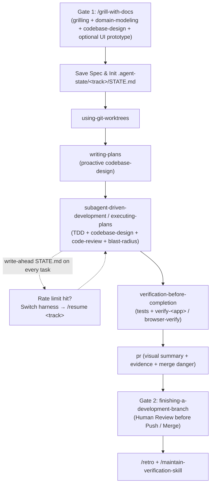

# Flow

A personal, harness-agnostic **Two-Gate SDLC** skills repository combining the best primitives from [Matt Pocock's `skills`](https://github.com/mattpocock/skills), [Jesse Vincent's `obra/superpowers`](https://github.com/obra/superpowers), and [Lauren Tan's (`@poteto`) `pstack`](https://github.com/cursor/plugins/tree/main/pstack) into one collision-free, end-to-end engineering pipeline.

---

## Core Design Philosophy

1. **Two Human Gates, Zero Mid-Build Noise**
   - **Gate 1 (`/grill-with-docs`)**: You are present up front. The agent grills every branch of the design tree, sharpens your domain language (`GLOSSARY.md`), records ADRs (`docs/adr/`), and settles architectural seams before writing a single line of code.
   - **Autonomous Middle**: Once you say go, you step away. The agent creates an isolated worktree, writes the plan, executes task-by-task with fresh subagents + RED-GREEN-REFACTOR TDD, **proactively keeps modules deep** (`codebase-design`), runs automated code reviews + `blast-radius` checks, proves the real app works (`verification-before-completion` + `verify-<app>` / fast `@playwright/cli` `browser-verify`), and drafts the PR (`pr`).
   - **Gate 2 (`finishing-a-development-branch`)**: The agent pauses **before pushing or merging** and hands you the verified diff, before/after proof, PR draft, and rulings list. After shipping, run `/retro` (and `/maintain-verification-skill` when app behavior changes).

2. **Seamless Cross-Harness Rate-Limit Switching (`/resume [folder]`)**
   - Rate limits happen while you're away—before you ever invoke `/handoff`.
   - Flow writes ahead to a repo-local, gitignored state file **`.agent-state/<folder>/STATE.md`** on every phase and task transition (supporting multiple tracks/projects via separate folders).
   - If Harness A dies mid-run, open Harness B (Claude Code, Antigravity, Cursor, Codex, OpenCode, Gemini CLI) and run `/resume <folder>`. It reconciles `STATE.md` against live `git status`, `git log`, and the plan file, and picks right back up.

3. **Unattended Overnight Execution (`/overnight`)**
   - Adapts Matt Pocock's `chief-of-staff` coordinator (DRI + fresh subagents + persistent dated wiki + 1-in-5 `/retro`) to drive Flow's full pipeline.
   - Enforces a **2-minute Interactive Pre-Flight** *before* you walk away—verifying your harness's unattended mode and running a live permission probe across `git`, tests, build, lint, and browser verification so it never stalls 30 minutes in on a permission prompt.

---

## End-to-End Flow



---

## Greenfield vs. Brownfield

Flow adapts automatically to where the repository is in its lifecycle:

- **Greenfield (0 commits / new repo):** Skips worktrees until an initial commit exists, builds a thin **Walking Skeleton** running end-to-end (with lint, typecheck, and 1 real test), commits it, runs `/create-verification-skill` once the app boots, then enters standard Two-Gate worktree cycles.
- **Brownfield (existing / legacy repo):** Snapshots any pre-existing failing tests on the base branch into `STATE.md` (so Gate 2 blocks only on *new* regressions), pins untested legacy modules with **characterization tests** before changing them, checks `git log` / `git blame` before deleting non-obvious code (**Chesterton's Fence**), and bounds proactive deepening strictly to touched seams.

---

## Effort Level Guide ("The Price of Rigor")

Flow defaults to **High / xHigh reasoning effort** across grilling, planning, coding, debugging, verification, and review.

In [`pstack`](https://github.com/cursor/plugins/tree/main/pstack), Lauren Tan (`@poteto`) frames why high reasoning budgets beat chasing cheap throughput:

> *"there's a growing sense that ai writes too much slop code. i agree. i don't want to ship like a team of twenty slop artists. throughput without quality is not a goal i aspire to. if you want to go fast, go deep first."*
>
> *"The defaults are the same as the `large` budget. Code, prose, and judgment run on Opus 5.5 at `xhigh` reasoning, and the review panels and swarm workers run at `high`... pstack spends extra tokens on subagents and review panels. That's the price of the rigor."*

And on automated verification:

> *"An agent that can check its own work keeps going until the check passes. An agent that can't hands every result back to you to check by hand. Of everything in this guide, the verification skill pays off the most."*

- **Default:** Run **High / xHigh** everywhere in Flow. Fewer subtle mistakes mean fewer rework cycles and less review time at Gate 2—and with `/resume <folder>`, hitting a rate limit on one harness is a 10-second switch to the next.
- **Optional budget lever (Matt Pocock's counterpoint):** If you are intentionally conserving quota on a single harness, Matt Pocock notes that once a spec and plan are tightly pinned, dropping to **Medium** can save tokens on pure file exploration, mechanical 1-file tasks, or `/teach` Q&A—never downgrade Gate 1 grilling, planning, debugging, or final whole-branch review.

---

## Installation (Any Harness)

### Universal (`skills.sh` — Antigravity, Cursor, Claude Code, Codex, OpenCode, Windsurf, Copilot)

```bash
npx skills@latest add webstriker-lab/Flow
```

Or clone directly and point your harness at `skills/`:

```bash
git clone https://github.com/webstriker-lab/Flow.git
```

### Gemini CLI

```bash
gemini skills install https://github.com/webstriker-lab/Flow.git --path skills/sdlc
gemini skills install https://github.com/webstriker-lab/Flow.git --path skills/verification
gemini skills install https://github.com/webstriker-lab/Flow.git --path skills/autonomous
gemini skills install https://github.com/webstriker-lab/Flow.git --path skills/productivity
gemini skills install https://github.com/webstriker-lab/Flow.git --path skills/meta
```

### Fast Browser UI Verification Prerequisite (`browser-verify`)

Install Microsoft's daemonized `@playwright/cli` once globally so any harness can drive web UIs quickly without MCP bloat:

```bash
npm install -g @playwright/cli@latest
```

### Per-Repo First-Time Setup

Open your project in any harness and run:

```text
/setup
```

This adds `.agent-state/` and `.worktrees/` to `.gitignore`, wires the slim `AGENTS.md` pointer, checks `playwright-cli`, and offers to generate your repo's `.agents/skills/verify-<app>/` harness via `/create-verification-skill`.

---

## Unattended `/overnight` Permission Setup (By Harness)

A Markdown skill cannot override a harness's OS-level tool-approval prompts once you walk away. Before launching `/overnight`, enable unattended permissions for your harness (inside a sandboxed repo/worktree) and let `/overnight`'s 2-minute Pre-Flight live-probe every command:

| Harness | Unattended Mode / Setting |
|---------|---------------------------|
| **Claude Code** | Configure project `allowedTools` in `.claude/settings.local.json` or launch with `claude --permission-mode bypassPermissions` |
| **Codex CLI** | Launch with `codex --full-auto` (workspace-write approval policy) |
| **Cursor** | Enable **Auto-Run** in Agent settings and allowlist your project's test/build/git commands |
| **Antigravity** | Enable **Terminal Auto-Run / Always Proceed** for the workspace before starting `/overnight` |
| **Gemini CLI / OpenCode** | Enable project-scoped auto-approve / yolo mode for the isolated worktree |

---

## Quick Usage Cheat Sheet

| Goal | Command |
|------|---------|
| Build a feature or refactor end-to-end | `/grill-with-docs <your idea>` |
| Resume after a rate limit in another harness | `/resume <folder-name>` (or `/resume` to pick) |
| Run a pre-grilled spec/plan while sleeping | `/overnight <folder-name>` |
| Set up Flow in a new repository | `/setup` |
| Generate a repo-local real-app verification skill | `/create-verification-skill` |
| Sync `verify-<app>` after UI/feature changes | `/maintain-verification-skill` |
| Improve repo guardrails after a session | `/retro` |
| Learn a new topic over multiple sessions | `/teach` (run in a dedicated learning directory) |
| Grill a non-code plan or document | `/grill-me` |
| Ask which skill fits right now | `/flow` |
| Debug why a Flow skill misfired | `/diagnosing-flow` |

---

## Skill Reference (32 Skills, 5 Categories)

Flow preserves Matt Pocock's clean **User-invoked** (`disable-model-invocation: true`, plus `agents/openai.yaml` for Codex) vs. **Model-invoked** (automatic or user-callable) split.

### 1. [`skills/sdlc/`](./skills/sdlc/README.md) — Core Two-Gate Engineering Pipeline (17)

| Skill | Invocation | Purpose |
|-------|------------|---------|
| [`using-flow`](./skills/sdlc/using-flow/SKILL.md) | Model | Session bootstrap: Two-Gate SDLC, continuous `STATE.md` checkpointing, mandatory skill discipline. |
| [`flow`](./skills/sdlc/flow/SKILL.md) | User (`/flow`) | Smart router over all Flow skills. |
| [`grill-with-docs`](./skills/sdlc/grill-with-docs/SKILL.md) | User (`/grill-with-docs`) | **Gate 1:** relentless design-tree interview + `GLOSSARY.md`/ADRs + deep seams + optional UI `prototype` → spec → autonomous handoff. |
| [`domain-modeling`](./skills/sdlc/domain-modeling/SKILL.md) | Model | Builds and sharpens `GLOSSARY.md` and `docs/adr/` inline. |
| [`codebase-design`](./skills/sdlc/codebase-design/SKILL.md) | Model | Proactive architectural deepening & deep-module seams wired into planning, execution, and review. |
| [`prototype`](./skills/sdlc/prototype/SKILL.md) | Model | Throwaway UI variants (3 structurally different layouts behind a floating `?variant=` switcher or standalone greenfield HTML) & logic demos during Gate 1. |
| [`using-git-worktrees`](./skills/sdlc/using-git-worktrees/SKILL.md) | Model | Creates isolated feature worktree/branch and verifies clean test baseline. |
| [`writing-plans`](./skills/sdlc/writing-plans/SKILL.md) | Model | Writes bite-sized TDD implementation plans (`docs/flow/plans/`) and hands off directly to execution. |
| [`subagent-driven-development`](./skills/sdlc/subagent-driven-development/SKILL.md) | Model | Fresh implementer subagent + two-stage review per task, with final whole-branch review. |
| [`executing-plans`](./skills/sdlc/executing-plans/SKILL.md) | Model | Inline single-context plan execution fallback when subagents aren't available. |
| [`dispatching-parallel-agents`](./skills/sdlc/dispatching-parallel-agents/SKILL.md) | Model | Concurrent subagents for genuinely independent tasks. |
| [`test-driven-development`](./skills/sdlc/test-driven-development/SKILL.md) | Model | Strict RED-GREEN-REFACTOR loop with behavior-focused tests. |
| [`systematic-debugging`](./skills/sdlc/systematic-debugging/SKILL.md) | Model | 4-phase root-cause debugging loop (root-cause tracing, defense-in-depth, condition-based waiting). |
| [`requesting-code-review`](./skills/sdlc/requesting-code-review/SKILL.md) | Model | Automated spec, code quality, and deep-module architecture review. |
| [`receiving-code-review`](./skills/sdlc/receiving-code-review/SKILL.md) | Model | Technical, non-performative handling of review findings. |
| [`pr`](./skills/sdlc/pr/SKILL.md) | Model | Concise PR draft: visual Summary, Before/After Evidence, Merge Danger / Blast Radius. |
| [`finishing-a-development-branch`](./skills/sdlc/finishing-a-development-branch/SKILL.md) | Model | **Gate 2:** runs final verification + PR draft, pauses for human review before merge/push, offers `/retro`. |

### 2. [`skills/verification/`](./skills/verification/README.md) — Hard Proof & Fast UI Testing (5)

| Skill | Invocation | Purpose |
|-------|------------|---------|
| [`verification-before-completion`](./skills/verification/verification-before-completion/SKILL.md) | Model | Iron law: fresh tests + `verify-<app>` / `browser-verify` output before claiming done. |
| [`browser-verify`](./skills/verification/browser-verify/SKILL.md) | Model | Fast daemonized UI verification (`@playwright/cli` primary, `agent-browser` / built-in fallback) with console, network, and screenshot proof. |
| [`create-verification-skill`](./skills/verification/create-verification-skill/SKILL.md) | User (`/create-verification-skill`) | Generates harness-neutral `.agents/skills/verify-<app>/` + feature map and proves it live once. |
| [`maintain-verification-skill`](./skills/verification/maintain-verification-skill/SKILL.md) | User (`/maintain-verification-skill`) | Source wave + live pass to prevent `verify-<app>` feature-map rot. |
| [`blast-radius`](./skills/verification/blast-radius/SKILL.md) | Model | Proves what a risky change could break beyond the diff by running real code. |

### 3. [`skills/autonomous/`](./skills/autonomous/README.md) — AFK Runs & Cross-Harness Continuity (3)

| Skill | Invocation | Purpose |
|-------|------------|---------|
| [`overnight`](./skills/autonomous/overnight/SKILL.md) | User (`/overnight`) | Chief-of-Staff AFK orchestrator: 2-min pre-flight + live permission probe → zero-question pipeline + wiki + decision log + 1-in-5 retro → morning report (never auto-merges). |
| [`resume`](./skills/autonomous/resume/SKILL.md) | User (`/resume [folder]`) | Cold-recovers from `.agent-state/<folder>/STATE.md` + git + plan in any harness after a rate limit. |
| [`handoff`](./skills/autonomous/handoff/SKILL.md) | User (`/handoff`) | Optional manual checkpoint for unplanned exploratory chats. |

### 4. [`skills/productivity/`](./skills/productivity/README.md) — Non-Code Grilling & Learning (3)

| Skill | Invocation | Purpose |
|-------|------------|---------|
| [`grill-me`](./skills/productivity/grill-me/SKILL.md) | User (`/grill-me`) | Relentless branching design-tree grill for non-code plans and ideas. |
| [`grilling`](./skills/productivity/grilling/SKILL.md) | Model | Reusable design-tree interview primitive behind `grill-me` and `grill-with-docs`. |
| [`teach`](./skills/productivity/teach/SKILL.md) | User (`/teach`) | Stateful multi-session personal tutor (`MISSION.md`, `RESOURCES.md`, spaced repetition). |

### 5. [`skills/meta/`](./skills/meta/README.md) — Setup, Retros & Skill Authoring (4)

| Skill | Invocation | Purpose |
|-------|------------|---------|
| [`setup`](./skills/meta/setup/SKILL.md) | User (`/setup`) | One-time per-repo bootstrap (`.gitignore`, `AGENTS.md`, `docs/adr/`, `playwright-cli` check, optional `/create-verification-skill`). |
| [`retro`](./skills/meta/retro/SKILL.md) | User (`/retro`) | Severity-ranked repo/harness improvements + `verify-<app>` drift check + deferred architecture review. |
| [`writing-for-agents`](./skills/meta/writing-for-agents/SKILL.md) | Model | Guide for writing skills, `AGENTS.md`, and agent-read docs (includes skill-testing checklist). |
| [`diagnosing-flow`](./skills/meta/diagnosing-flow/SKILL.md) | User (`/diagnosing-flow`) | Transcript-based debugger when a Flow skill misfires or gets skipped. |

---

## Credits & License

MIT Licensed — see [LICENSE](./LICENSE). Built with gratitude on the open-source foundations of:
- **Matt Pocock** — [`mattpocock/skills`](https://github.com/mattpocock/skills)
- **Jesse Vincent / Prime Radiant** — [`obra/superpowers`](https://github.com/obra/superpowers)
- **Lauren Tan (`@poteto`) / Cursor** — [`cursor/plugins/pstack`](https://github.com/cursor/plugins/tree/main/pstack)
- **Dex Horthy / Humanlayer** — `show-me` PR template pattern
